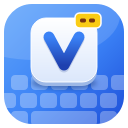
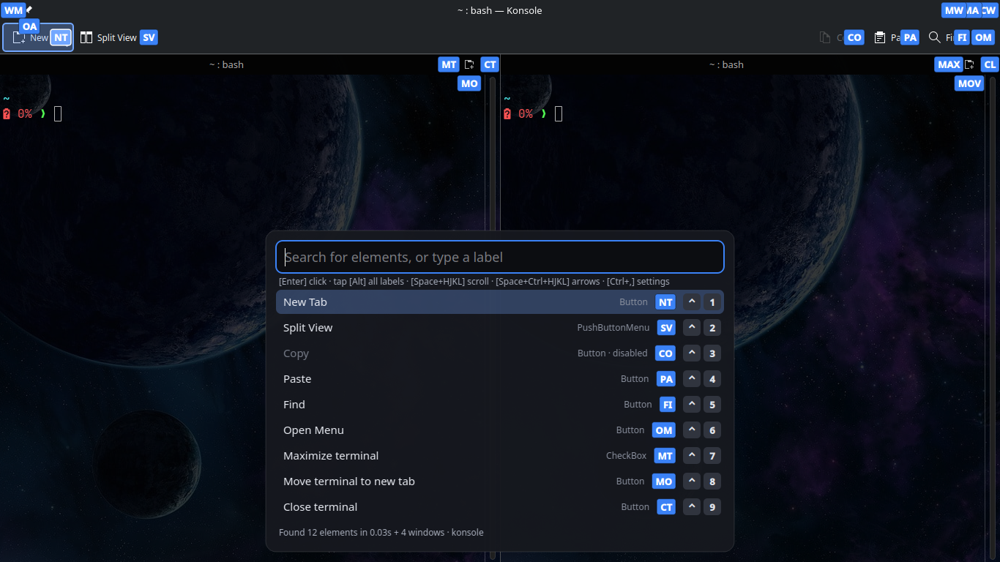

# vimvibe

**Click anything on your Linux desktop by typing its name — or the two letters on its label.**
An open-source, Linux-native take on [Shortcat](https://shortcat.app) (macOS), and Vimium's link hints for the whole
desktop instead of just the browser.

Press **Meta+Shift+Space** in any app. Every button, link, tab and field in the focused window gets a small letter label
(`SA` for *Save*, `PR` for *Pull requests*). Type the label or part of the name, press **Enter**, done — no mouse.



*vimvibe over Konsole (default blue theme): a label on every control, including the title-bar buttons and the buttons
inside each split terminal; the panel lists the matches with their labels and Ctrl+1…9 shortcuts.*

> **Status: working prototype.** Built and tested on Fedora 44, KDE Plasma 6.7 on Wayland. Other desktops are planned
> (see [research/11](research/11-os-scope-plan.md)). Expect rough edges; reports are welcome.

- [How it works](#how-it-works)
- [Install](#install)
- [Quick start](#quick-start)
- [Using it](#using-it)
- [Settings](#settings)
- [Scrolling and arrow keys](#scrolling-and-arrow-keys)
- [Keyboard mouse](#keyboard-mouse)
- [Customizing keys](#customizing-keys)
- [Excluding apps](#excluding-apps)
- [Making apps visible](#making-apps-visible-accessibility)
- [Troubleshooting](#troubleshooting)
- [Commands](#command-reference)
- [Upgrading and developing side by side](#upgrading-and-developing-side-by-side)
- [Developer guide](#developer-guide)
- [Shortcat feature parity](#shortcat-feature-parity)
- [Privacy and security](#privacy-and-security)

## How it works

```
 Meta+Shift+Space ──► vimvibe-core daemon (Rust)                     vimvibe overlay (Python/Qt)
                       • knows the focused window (KWin script)  ──► • search panel + letter labels
                       • reads its elements (AT-SPI accessibility)    • sends your choice back
                       • assigns labels, ranks search results    ◄── over D-Bus
                       • acts: the app's own action first, pointer click only as a fallback
```

- **Semantic first.** vimvibe reads the same accessibility tree screen readers use, so it knows each element's *name*
  and *role*, and it activates elements through the app itself (no mouse needed for most clicks).
- **Pointer fallback.** Some controls can't be activated that way (GTK4 check boxes, for example). For those, and for
  right click / hover, vimvibe clicks through the desktop's Remote Control permission, which your desktop asks you for
  once. The pointer goes back where it was.
- **Fast and light.** The daemon idles at ~10 MB and zero CPU (no polling). Opening the overlay on a typical window takes
  10–40 ms; a big Chrome page ~100–200 ms.

## Install

Requirements: KDE Plasma 6 (Wayland), Rust (`cargo`), Python 3 with PySide6, `gdbus`.

```bash
# Fedora
sudo dnf install cargo python3-pyside6 glib2
# Debian/Ubuntu: sudo apt install cargo python3-pyside6.qtwidgets libglib2.0-bin   (or: pip install --user PySide6)
# Arch:          sudo pacman -S rust pyside6 glib2

git clone <this repo> vimvibe && cd vimvibe
./install.sh
```

`install.sh` builds the core and installs, for your user only (no root):

| File | What |
|---|---|
| `~/.local/bin/vimvibe-core` | the core and daemon |
| `~/.local/bin/vimvibe` | launcher: `start`, `stop`, `settings`, `doctor`, … |
| `~/.local/share/vimvibe/` | the overlay and the Settings window |
| `~/.local/share/icons/hicolor/…/vimvibe.*` | the icon (SVG + 16–512 px PNGs) |
| `~/.local/share/applications/vimvibe.desktop` | the "vimvibe Settings" entry in your app menu |

Make sure `~/.local/bin` is on your `PATH` (Fedora has it by default). Uninstall with `./install.sh --uninstall`
(your settings in `~/.config/vimvibe/` are kept).

## Quick start

```bash
vimvibe start             # starts the daemon and the overlay; the daemon turns desktop accessibility on
# now restart the apps you want to use (apps started before accessibility was on stay invisible)
vimvibe doctor            # checks your setup and lists which open apps vimvibe can see
vimvibe doctor --fix-env  # optional: keep accessibility on for Qt/GTK apps from the start of your next login
```

Press **Meta+Shift+Space** in, say, Dolphin or System Settings. Then:

- type `sa` → the *Save* label is selected → **Enter**
- or type `save` → **Enter**
- **Esc** closes it.

To start vimvibe automatically, tick *Launch at login* in `vimvibe settings`.

For clicks that need the pointer (see [How it works](#how-it-works)), allow it once:
`vimvibe-core pointer-setup` (your desktop shows a *Remote Control* dialog; allow the pointer, and the keyboard if
you want Space + H/J/K/L arrow keys).

## Using it

| Do | Keys |
|---|---|
| Open / close | **Meta+Shift+Space** (Esc also closes) |
| Quit vimvibe completely (daemon + overlay) | **Meta+Shift+Q** (or `vimvibe stop`) |
| Settings | **Ctrl+Shift+,** from anywhere (**Ctrl+,** while the overlay is open) |
| Scroll | hold **Space** + **J** (down) / **K** (up) / **H** (left) / **L** (right), or **D** / **U** — scrolls the selected element, or the window; **Shift** = faster; release Space for fresh labels ([details](#scrolling-and-arrow-keys)) |
| Arrow keys in the app | hold **Space** + **Ctrl** + **H J K L** — ← ↓ ↑ → (needs the keyboard permission); keep Space held and press H J K L |
| Pick an element | type its **label** (`pr`) or part of its **name** (`pull`), then **Enter** |
| Right click / double click / middle click | **Ctrl+Enter** / **Alt+Enter** / **Shift+Enter** |
| Move the pointer onto it (hover) | **tap Ctrl** |
| Give it keyboard focus (e.g. a text field) | **tap Ctrl twice** |
| Act on result row *n* / just select it | **Ctrl+1…9** / **Ctrl+Shift+1…9** |
| Move the selection | **↑ ↓**, **Tab / Shift+Tab**, **Ctrl+N / Ctrl+P**, **PageUp / PageDown**, mouse wheel |
| Mouse grid: pick a spot on screen by typing letters | **Ctrl+G**, then two letters per zoom level, **Enter** clicks ([details](#keyboard-mouse)) |
| Move the pointer with the keyboard | **Ctrl+M**, then hold **H J K L** (**Shift** faster, **Alt** precise), **Enter** clicks |
| Hide / show the search panel (labels stay) | **Ctrl+Space** ([rebind it](#customizing-keys)) |
| Clear the search, show every label again | **tap Alt** |
| Re-read the window (after the page changed) | **Ctrl+R** |
| Switch to another window | type its app or title (e.g. `konsole`) → **Enter** |
| Launch an app | type its name (`calculator`, `firefox`) → **Enter** |
| Use the start menu, tray or calendar popups | open the popup, then **Meta+Shift+Space**: its items get labels and the popup stays open |
| Use an open menu (also nested submenus) | open it, then **Meta+Shift+Space**: every level of the menu gets labels and stays open |
| Click something on the taskbar / panel | its buttons, tasks and tray icons are labelled in every window |
| Close / maximize / minimize the window | its title-bar buttons have labels too (`CW`, `MA`, `MW`) |
| Mouse | click a label or a row to activate it; click anywhere else to close |

Search tips (as in Shortcat): one or two words beat long queries; add a role word to narrow results — `btn`,
`button`, `link`, `check`, `radio`, `tab`, `menu`, `field` (`save btn`). While you type, only labels that start
with what you typed stay visible; letters already typed are dimmed.

**Continuous mode** (off by default): after each click vimvibe re-reads the window and comes back, ready for the next
click — good for browsing. It stops on Esc, after you act on a text field, or when a menu/another window takes over.

## Settings

Open the Settings window with **Ctrl+Shift+,** (or `vimvibe settings`). It has a live preview of the labels and edits
`~/.config/vimvibe/config.toml`, which you can also edit by hand. Changes apply the next time the overlay opens.

| Tab | What you can set |
|---|---|
| General | shortcuts (changed in System Settings), launch at login, window switching, app launching, panel labels |
| Appearance | theme presets (Blue, Shortcat, Nord, Dracula, Gruvbox, Solarized light, High contrast); label background, text, outline and selected colours; font; label text size; overall label size; corner radius; capitals; panel style (dark/light), opacity, width, result rows, text size, position, key-hint line, hide-until-typing; screen dimming |
| Labels & behaviour | when labels appear (immediately … 5 s, after input), Vimium-style auto-click, continuous mode, and the scrolling group: what Space+HJKL does, direction keys, distance, Shift multiplier, smooth animation and its length, natural direction, swap left/right |
| Keys | every key the overlay uses, with Change / Add / Reset per action, and conflict warnings |
| Excluded apps | apps vimvibe must never read or click |
| Accessibility & setup | setup check, turn accessibility on, keep it on after login, allow pointer and keyboard control |

```toml
[ui]
theme = "Blue"             # preset the colours came from (informational)
accent = "#3b82f6"         # label background ("#facc15" + label_text "#000000" = Shortcat's look)
label_text = "auto"        # label text colour; auto = black or white, whichever reads
label_border = "auto"      # label outline colour
selected = "auto"          # highlight of the selected element/label (Shortcat uses light green, "#86efac")
font = ""                  # font family; empty = desktop font
label_font_size = 0        # points; 0 = automatic
label_scale = 1.0          # overall label size, 0.6–2.0
label_radius = 3           # corner radius, px
uppercase = true           # SA vs sa (typing is case-insensitive)
panel = "auto"             # auto | top | center | bottom
panel_theme = "dark"       # dark | light
panel_opacity = 0.96
panel_width = 640
rows = 9                   # result rows shown (Ctrl+1..9 reach the first nine)
panel_font_size = 0        # points; 0 = automatic
hint_line = true
hide_panel_until_typing = false   # labels only until you type (Shortcat's "hide query pane")
start_hidden = false       # open with the panel hidden; the toggle_panel key (Ctrl+Space) shows it
dim = 0                    # darken the screen behind the labels, percent 0–60

[hints]
delay_ms = 0               # when labels appear after opening (Shortcat's default is 2000)
after_input = false        # true: labels appear only once you start typing
auto_activate = false      # true: a fully typed label clicks at once (Vimium-style), no Enter

[behavior]
continuous = false         # come back after each click
continuous_delay_ms = 500

[keys]                     # only what you changed is written; see "Customizing keys"
toggle_panel = ["Ctrl+Space"]

[scroll]
keys = "hjkl"              # direction keys: "hjkl" (Vim) or "ijkl"
hjkl = "scroll"            # Space + H J K L: "scroll" or "arrows" (Space + Ctrl + key does the other one)
distance = 1.0             # mouse-wheel notches per press (about 3 lines)
fast = 4                   # Shift multiplies the distance by this
smooth = true              # glide like a smooth-scrolling mouse wheel instead of jumping
smooth_ms = 220            # how long a glide takes to settle
edge_keys = true           # Space + g g = top, Space + Shift+G = bottom
edge_notches = 600.0       # how far a jump to top/bottom travels (the app stops at the end)
edge_ms = 600              # how long that jump takes
natural = false            # touchpad-style direction
invert_horizontal = false  # swap left and right for H / L

[mouse]
enabled = true             # master switch for the keyboard mouse (grid and H J K L movement); false turns it all off
open_in = "search"         # what vimvibe opens in: "search" or "grid"
scope = "window"           # what the grid covers at first: "window" or "screen"
cols = 5                   # cells per grid level
rows = 5
alphabet = "abcdefghijklmnopqrstuvwxyz"   # cell names are a row letter + a column letter from this
max_depth = 4              # how many times a cell can be divided again
keys = "hjkl"              # pointer movement keys: "hjkl" or "ijkl"
speed = 500                # px per second
fast = 3                   # Shift multiplies the speed by this (Alt slows it to a quarter)
accelerate = true          # speed up while a key is held

[search]
windows = true             # offer your other open windows as results (window switching)
apps = true                # offer installed applications as results
panel = true               # label Plasma's panels (only while they are visible)

[apps]
exclude = ["keepassxc", "org.kde.konsole"]

[accessibility]
enable_on_start = true     # the daemon turns desktop accessibility on when it starts
offer_restart = true       # offer to restart a Chromium-based app (Chrome, Brave, Electron) that shows nothing, with accessibility on
```

One-off colour for a single run: `python3 ~/.local/share/vimvibe/vimvibe_palette.py --accent orange`
(or set `VIMVIBE_ACCENT`).

## Scrolling and arrow keys

While the overlay is open you can scroll and move around the app from the home row, like Shortcat's *Arrow Keys /
Scroll* feature. Hold **Space** and press:

| Keys | Does |
|---|---|
| **Space** + **J** / **K** | scroll down / up |
| **Space** + **H** / **L** | scroll left / right |
| **Space** + **D** / **U** | scroll down / up (a second pair, handy with the left hand) |
| add **Shift** | scroll *faster* (4× by default) |
| **Space** + **Ctrl** + **H J K L** | arrow keys ← ↓ ↑ → in the app (needs the keyboard permission). The first press only switches arrow mode on; keep Space held and use H J K L — every press is then a plain arrow |
| release **Space** | the window is re-read and vimvibe comes back with fresh labels |
| **Esc** | stop |

What scrolls: the selected result's element when you have typed something (type `files`, then Space + J scrolls that
list), otherwise the middle of the window. The pointer is parked there for the scroll and put back afterwards.

Everything is configurable in *Settings → Labels & behaviour → Scrolling and arrow keys* (or `[scroll]` in the
config):

| Setting | What it does |
|---|---|
| Space + H J K L | **Scroll** (default) or **Arrow keys**; Ctrl swaps to the other one |
| Direction keys | H J K L (Vim) or I J K L (I up, K down, J left, L right) |
| Scroll distance | mouse-wheel notches per press (default 1; about 3 lines) |
| With Shift held | the multiplier (default ×4) |
| Smooth scrolling / glide length | each press adds to a smooth glide (a critically damped spring: gentle start, no overshoot, 220 ms to settle by default). A held key flows into one continuous motion, like a smooth-scrolling mouse wheel; with it off, a press jumps |
| Top / bottom (`gg`, `G`) | **Space + g g** scrolls to the top and **Space + Shift+G** to the bottom, like Vimium (on by default); the jump distance and time are settable. It is one long glide of `edge_notches` that the app stops at the end of its content, so a page longer than that needs a second press. Not available in arrow mode (Space + Ctrl + keys) |
| Natural direction | touchpad-style: the content follows your finger |
| Swap left and right | if H should scroll right and L left |

### How scrolling works

Smooth scroll events (about 125 a second, fractions of a wheel notch each) sent through the desktop's Remote Control permission, so it works in every app, accessible or
not; while you scroll, the overlay lets the wheel events through to the app below. No modifier keys are used on
purpose (Shortcat uses Space + Cmd): on Linux apps give the wheel another meaning when one is held — Ctrl + wheel
zooms (Dolphin then does not scroll at all), Shift + wheel scrolls sideways, Alt + wheel is "back" in some browsers.

### How arrow keys work (and where they don't)

On Wayland an app may not type into another app, so arrow keys go through the keyboard part of the Remote Control
permission. When you enter arrow mode vimvibe hides, the app gets the keyboard back, and vimvibe watches only for the
H J K L / I, D / U, Space and Esc keys (through the accessibility keystroke listener screen readers use), turning H J K L
into arrow keys; every other key goes to the app as usual. Releasing Space gives everything back. The keys are matched
by their **position** on the keyboard, so they work on Dvorak, Colemak or AZERTY too.

That listener only sees keys in apps that share their key presses with accessibility: **KDE/Qt apps and GTK 3 apps
(Firefox, GIMP, …)**. In **Chrome/Electron and GTK 4** apps vimvibe could not tell your J from typing, so it checks
first (it taps Shift and looks whether the tap arrives) and, if it can't, says so and does nothing — scrolling works
everywhere. Without the keyboard permission, Space + Ctrl + H J K L scrolls instead and a notice tells you how to allow
the keyboard.

### The permission

```bash
vimvibe-core pointer-setup      # or Settings → Accessibility & setup → "Allow pointer and keyboard control…"
```

Your desktop shows its *Remote Control* dialog once: allow **pointer** (clicks, scrolling, right click, hover) and
**keyboard** (only used for the arrow keys). KDE remembers the answer; vimvibe never opens the dialog on its own.
`vimvibe doctor` shows what is allowed. (Scrolling needs the pointer part only.) Revoke it any time in **System Settings → Security & Privacy → Remote
Control**, or delete `~/.local/state/vimvibe/pointer-token`.

## Keyboard mouse

Move and click the pointer without the mouse, for anything vimvibe has no label for (canvases, maps, games, video
players). Open vimvibe as usual, then:

**The grid — Ctrl+G.** The target window is divided into 5 × 5 cells named by two letters: the row letter, then the
column letter (`aa ab ac ad ae` across the top row, `ba bb …` below). Type a cell's two letters and it fills the view and
is divided again; keep going as deep as you like (4 times by default). Then:

| Key | Does |
|---|---|
| **Enter** | click the middle of the current cell (**Ctrl+Enter** right, **Alt+Enter** double, **Shift+Enter** middle click) |
| **Space** | only move the pointer there, no click |
| **Backspace** | zoom out one step (or drop a half-typed cell name) |
| **Ctrl+Shift+G** | switch between the window and the whole screen |
| **Ctrl+M** | continue with H J K L from here |
| **Esc** | back to the search (a second Esc closes) |

Clicking a cell with the mouse zooms into it; right click zooms out.

**H J K L movement — Ctrl+M.** Hold a direction key and the pointer glides, getting faster the longer you hold; two keys
make a diagonal. **Shift** is faster, **Alt** is precise. **Enter** clicks where the pointer is (same modifiers as above),
**Space** leaves it there, **Esc** goes back. The page under the pointer shows hover effects as you move.

Everything is customizable in **Settings → Mouse** (the `[mouse]` table above): grid size and letters, how deep a cell
can be divided, whether the grid covers the window or the screen, speeds, the movement layout, opening vimvibe
straight in the grid — or turn the whole feature off with *Keyboard mouse*. The keys are in **Settings → Keys**
(`mouse_grid`, `mouse_move`, `mouse_place`, `mouse_scope`, `mouse_back`; Enter and the click variants are the same keys
as in the search). The pointer ends where you put it and stays there. It needs the pointer permission
([see above](#the-permission)); the grid covers the screen the window is on, and it is not available over Plasma popups.

## Customizing keys

Every key the overlay reacts to can be changed in **Settings → Keys**: click *Change…* and press the combination you
want, *Add…* gives an action a second key, *Reset* restores its default. The window warns when two actions share a
key, and before you bind a plain typing key (it would stop typing that character into the search field). The same is
possible by hand in `[keys]`; a value is a string or a list, and an empty list unbinds the action:

```toml
[keys]
toggle_panel = ["Ctrl+Space"]          # hide / show the search panel (labels and typing keep working)
click = ["Return", "Enter"]
right_click = ["Ctrl+Return"]
double_click = ["Alt+Return"]
middle_click = ["Shift+Return"]
close = ["Escape"]
settings = ["Ctrl+,", "Ctrl+Shift+,"]
refresh = ["Ctrl+R"]
next = ["Down", "Tab", "Ctrl+N"]
prev = ["Up", "Shift+Tab", "Ctrl+P"]
page_down = ["PgDown"]
page_up = ["PgUp"]
row_act = ["Ctrl"]                     # + 1…9: act on that result row
row_select = ["Ctrl+Shift"]            # + 1…9: only select it
tap_labels = ["Alt"]                   # tap alone: clear the search, show every label (Ctrl, Alt, Shift or [] = off)
tap_hover = ["Ctrl"]                   # tap alone: hover (twice: focus)
mouse_grid = ["Ctrl+G"]                # keyboard mouse: the zooming grid
mouse_move = ["Ctrl+M"]                # keyboard mouse: H J K L moves the pointer
mouse_place = ["Space"]                # keyboard mouse: leave the pointer here, no click
mouse_scope = ["Ctrl+Shift+G"]         # grid: window / whole screen
mouse_back = ["Backspace"]             # grid: zoom out
```

Limits: the global shortcuts that open and quit vimvibe are KDE shortcuts (System Settings → Shortcuts → *vimvibe*,
linked from the Keys tab). Space + H J K L / D / U follow physical key positions (they are also read by the daemon);
choose between the Vim and the arrow layout in *Labels & behaviour*. Over the start menu and other popups vimvibe can't
see most Ctrl/Alt combinations, so the keys there keep their defaults (Ctrl+Space, hide / show the panel, is the one exception).

## Excluding apps

Apps listed under `[apps] exclude` are **never read and never acted on**: when one of them is focused and you press the
shortcut, vimvibe doesn't look at its window at all and shows a notification instead. They are also left out of window
switching. Good candidates: password managers, banking apps, terminals with secrets, remote-desktop clients.

An entry matches (case-insensitively) the app's accessibility name, its window class (`org.kde.konsole`, and the
short form `konsole`) or its process name. Add entries in *Settings → Excluded apps*.

## Making apps visible (accessibility)

vimvibe can only see apps that expose an accessibility tree. `vimvibe doctor` lists which open apps are visible.

| App type | What to do |
|---|---|
| Qt / KDE apps, GTK 3/4 apps, Firefox | turn accessibility on (`vimvibe doctor --fix`), then **restart the app** |
| Chrome, Chromium, Edge, Brave, Vivaldi, any Chromium engine | need `--force-renderer-accessibility` (nothing on the accessibility bus can switch it on later — measured). vimvibe takes care of it: open vimvibe over such a window that shows nothing and it offers to **restart the app with the flag** (tabs come back) and fixes its menu launchers so it starts that way from then on. Same thing by hand: `vimvibe doctor --fix-chrome`, then quit the browser completely. Programs are recognised by their files, not their name. Turn the offer off with `[accessibility] offer_restart = false` |
| Electron apps (VS Code, Discord, Slack, …) | same as Chromium: vimvibe offers the restart |
| Java apps | need the Java ATK bridge |
| Games, Tk, Wine, apps drawn without a toolkit | not supported yet (a pixel-based fallback is planned) |

Accessibility is a session setting that is off by default on most distributions; `vimvibe doctor --fix-env` writes
`~/.config/environment.d/50-vimvibe-accessibility.conf` so toolkits enable it after your next login.

## Troubleshooting

| Problem | Fix |
|---|---|
| Nothing happens on Meta+Shift+Space | `vimvibe status`: are the daemon and overlay running? `vimvibe start`. Is the shortcut taken by something else? (`vimvibe doctor`) |
| Notification "can't read this window" | the app started before accessibility was on, or has no accessibility: restart it (see table above) |
| The start menu closes when vimvibe opens | the overlay could not use layer-shell (`layer-shell-qt`, normally installed with Plasma): check `vimvibe logs` |
| vimvibe keeps running / want it gone | **Meta+Shift+Q**, or `vimvibe stop` |
| Notification "vimvibe is off for this app" | it's in your excluded list |
| Few or no labels in Chrome/Electron | `vimvibe doctor --fix-chrome`, then quit the app completely and reopen it from the menu (or start it with `--force-renderer-accessibility`) |
| Labels in the wrong place | report it with your scaling and monitor setup (HiDPI/multi-monitor are not tested yet) |
| "pointer control is not set up" | run `vimvibe-core pointer-setup` once and approve the dialog |
| "Arrow keys need keyboard permission" | run `vimvibe-core pointer-setup` again and allow the keyboard too |
| "can't send arrow keys here" | the app (Chrome/Electron, GTK 4) doesn't share key presses with accessibility: scroll with Space + J / K instead |
| Scrolling does nothing | hold **Space** and press **J / K / H / L** or **D / U** — no Ctrl (apps treat Ctrl+wheel as zoom); it needs the pointer permission (`vimvibe doctor`); some views move only a little per step — raise *Scroll distance* in Settings; a press moves one wheel notch by default |
| Space + J types arrow keys into my terminal | *Settings → Space + H J K L* is set to "Arrow keys"; set it to "Scroll" (the default) |
| Want to stop vimvibe from clicking or typing arrow keys | System Settings → Security & Privacy → Remote Control, or delete `~/.local/state/vimvibe/pointer-token` |
| Logs | `vimvibe logs` (`~/.local/state/vimvibe/`) |

## Command reference

```text
vimvibe start | stop (= quit) | restart | status | settings | logs | open | help
vimvibe doctor [--fix] [--fix-env] [--fix-chrome]

vimvibe-core <command> [--app NAME] [--json] [--strategy auto|cache|walk] ...
  daemon            the resident service (what `vimvibe start` runs)
  doctor            setup check
  pointer-setup     one-time permission for clicks, scrolling and arrow keys
  list              list the focused window's elements        (vimvibe-core --app dolphin list)
  search QUERY      search them                               (vimvibe-core --app dolphin search "new folder")
  act QUERY         activate the best match                   (--index N, --dry-run)
  status | apps | focus | watch | cursor | click X Y | serve | surfaces
  key KEY…          type keys into the focused window (testing; e.g. `key Down j -- +space -space`)
```

`vimvibe-core --help` and `vimvibe-core <command> --help` print every option.

## Upgrading and developing side by side

**Use it** — install once, update whenever you like:

```bash
git pull && ./install.sh        # an upgrade in place: stops the running vimvibe, installs, starts it again
vimvibe version                 # what is installed
```

Your settings (`~/.config/vimvibe/`) and the pointer/keyboard permission survive upgrades and `--uninstall`.

**Develop it at the same time** — the source tree runs as a separate **dev profile** that cannot collide with the
installed one:

```bash
./dev.sh start                  # builds (only what changed), then starts the dev daemon + overlay
./dev.sh restart                # after you change code
./dev.sh settings | status | logs | doctor | stop
```

| | installed (`vimvibe …`) | dev (`./dev.sh …`) |
|---|---|---|
| program | `~/.local/bin/vimvibe-core`, `~/.local/share/vimvibe/` | `core/target/release/…`, `palette/` in the repo |
| D-Bus name | `org.vimvibe.Daemon` | `org.vimvibe.DaemonDev` |
| shortcuts (KDE group) | **Meta+Shift+Space**, **Meta+Shift+Q**, **Ctrl+Shift+,** (*vimvibe*) | **Meta+Alt+Space**, **Meta+Alt+Q**, **Ctrl+Alt+,** (*vimvibe-dev*) |
| settings | `~/.config/vimvibe/` | `~/.config/vimvibe-dev/` (starts from your installed settings, never writes to them) |
| logs | `~/.local/state/vimvibe/` | `~/.local/state/vimvibe-dev/` |
| launch at login | yes (if you tick it) | no |
| pointer/keyboard permission | shared (`~/.local/state/vimvibe/`) | approve once for both |

So you can keep the installed copy for daily use, try a change with **Meta+Alt+Space**, and only run `./install.sh`
when the change is good. Any command can target the dev copy with `VIMVIBE_PROFILE=dev` (for example
`VIMVIBE_PROFILE=dev core/target/release/vimvibe-core doctor`); a third copy is `VIMVIBE_PROFILE=beta`.

**Releases and patches** — keep the installed copy on a known version while `main` moves on:

```bash
git tag v0.2.0                                   # mark a release (bump `version` in core/Cargo.toml first)
git worktree add ../vimvibe-stable v0.2.0        # a checkout of exactly that release
(cd ../vimvibe-stable && ./install.sh)           # install it
# ... develop in this tree with ./dev.sh; for a patch: fix, tag v0.2.1, then in ../vimvibe-stable:
git -C ../vimvibe-stable checkout v0.2.1 && (cd ../vimvibe-stable && ./install.sh)
```

## Developer guide

### Build and run from the source tree (no install)

```bash
cargo build --release --manifest-path core/Cargo.toml   # binary: core/target/release/vimvibe-core
cargo test  --release --manifest-path core/Cargo.toml   # unit tests

./dev.sh start                                          # daemon + overlay as the separate dev profile (recommended)
# or by hand, as the installed profile (stop the installed copy first: both would want the same shortcuts):
core/target/release/vimvibe-core daemon &
VIMVIBE_DEBUG=1 python3 palette/vimvibe_palette.py      # overlay with debug output
python3 palette/vimvibe_palette.py --settings           # the Settings window
```

Useful while developing:

```bash
core/target/release/vimvibe-core --app dolphin list            # what vimvibe sees in an app
core/target/release/vimvibe-core --app dolphin search "folder"
VIMVIBE_DEBUG=1 core/target/release/vimvibe-core focus         # which window it would target, and why
python3 palette/vimvibe_palette.py --trigger --query sa --quit-after 5   # open once without the shortcut
```

### Layout

```
core/                Rust: AT-SPI reading, matching, labels, KWin bridge, daemon, pointer, doctor
  src/enumerate.rs   find the target window, read its elements (Cache / concurrent walk)
  src/matcher.rs     fuzzy search with role words and synonyms
  src/hints.rs       letter labels
  src/model.rs       elements and the activation ladder (action → selection → focus → pointer)
  src/kwin.rs        KWin scripts: focus, geometry, window list, raise, cursor
  src/daemon.rs      D-Bus service org.vimvibe.Daemon
  src/pointer.rs     RemoteDesktop portal clicks
  src/config.rs      ~/.config/vimvibe/config.toml (parts the daemon enforces), profiles (dev next to installed)
  src/doctor.rs      setup check
packaging/icons/     the icon: vimvibe.svg (edit this) and the generated PNG sizes (`python3 packaging/icons/make-icons.py`)
palette/             Python/Qt: overlay (vimvibe_palette.py), Settings window (vimvibe_settings.py),
                     shared config + theme (vimvibe_style.py), key bindings (vimvibe_keys.py, tests: test_keys.py), the mouse grid logic (vimvibe_mouse.py, tests: test_mouse.py)
packaging/           launcher script, optional systemd user unit
research/            design notes and measurements (start with 09, 10, 11)
```

### D-Bus API

Any UI can drive the daemon (session bus, `org.vimvibe.Daemon`, path `/org/vimvibe/Daemon`):

| Method / signal | |
|---|---|
| `Trigger() → json` | snapshot the focused window (toggles); emits `Opened(json)` or `Refused(json)` |
| `Search(q) → json` | ranked hits `[{id, hint, score, element, screen}]`; a query equal to a label puts that element first |
| `Elements() → json` | every element with id, label, role, screen rectangle |
| `Activate(i)` / `ActivateId(id)` / `ActivateWith(id, action)` | act on a hit / an element; action = `click right double middle hover focus` |
| `Refresh()` | re-read the same window |
| `RestartWithAccessibility(pid)` | restart a Chromium-based app (only a main process that lacks `--force-renderer-accessibility`) with the flag, restoring its session, and fix its launchers |
| `PointerMotion(dx, dy)`, `PointerAct(x, y, here, action)` | the keyboard mouse: move the pointer by whole pixels (no waiting); close the overlay, then `move`/`click`/`right`/`double`/`middle` at (x, y) or, with `here`, where the pointer is (`goto` only moves, keeping the overlay). Refused when `[mouse] enabled` is false |
| `ScrollStart(id)`, `Scroll(dx, dy)`, `ScrollEdge(dir)`, `ScrollEnd()` | park the pointer over element `id` (or the window), glide by `dx`/`dy` tenths of a wheel notch (returns at once; the glide carries on), jump to the top (`dir` -1) or bottom (1), put the pointer back after the glide |
| `ArrowStart(dx, dy)`, `ArrowEnd(reopen)` | arrow-key mode: hide, take the physical H/J/K/L/I, D/U, Space, Esc keys and send arrows; Space release reopens |
| `Close()`, `Status() → json`, `Quit()` | `Quit` = Meta+Shift+Q |
| signals `Opened(json)`, `Closed()`, `Refused(json)`, `Quitting()`, `Key(json)`, `OpenSettings()` | |

Try it: `gdbus call --session --dest org.vimvibe.Daemon --object-path /org/vimvibe/Daemon --method org.vimvibe.Daemon.Status`

## Shortcat feature parity

| Shortcat | vimvibe |
|---|---|
| Search elements by name, role words, synonyms | ✅ |
| Letter labels (hints) on every element, typed to select | ✅ (2–3 letters; colour configurable) |
| Label delay setting (immediately … 5 s, after input) | ✅ |
| Enter click · Ctrl+Enter right click · double click | ✅ (double click = Alt+Enter) |
| Tap Ctrl to hover · double-tap to focus | ✅ |
| Cmd+number act on row · Cmd+Shift+number select | ✅ as Ctrl+number / Ctrl+Shift+number |
| Option shows all labels | ✅ tap Alt |
| Tab / Ctrl+N / Ctrl+P navigation | ✅ |
| Cmd+R refresh | ✅ Ctrl+R |
| Continuous mode | ✅ (experimental, as in Shortcat) |
| Window switching, minimised windows | ✅ (KDE) |
| Custom activation shortcut, launch at login | ✅ (shortcut via System Settings) |
| Launch applications | ✅ (installed apps; also from the start menu) |
| Window title-bar buttons | ✅ (close, maximize, minimize, window menu, all desktops) |
| Menu bar / app menu search, Dock | ⏳ planned ([research/11](research/11-os-scope-plan.md)) |
| Space+Cmd+HJKL scroll | ✅ as Space + HJKL / D / U (no modifier: Ctrl+wheel is zoom on Linux), smooth glide and distance settings, plus `gg` / `G` for top and bottom, in every app |
| Space+HJKL arrow keys (IJKL option, keycode-based) | ✅ as Space + Ctrl + HJKL in KDE/Qt and GTK 3 apps, with the desktop's keyboard permission (swappable in Settings) |
| Preferences window (Cmd+,) | ✅ Ctrl+Shift+, anywhere, Ctrl+, in the overlay; plus label/panel theming Shortcat doesn't offer |
| Hide query pane by default | ✅ `hide_panel_until_typing` |
| Emoji search with `:` | ⏳ planned |
| Cmd+Enter / Shift+Enter modifier clicks | ⏳ planned (Shift+Enter is middle click for now) |
| — | ➕ excluded-apps list, setup doctor, works with any UI over D-Bus |

## Privacy and security

- Everything runs locally. vimvibe has no network code and sends nothing anywhere.
- It reads element names only from the window you trigger it on, only when you trigger it, and keeps them in memory
  until the overlay closes. Window titles are used for window switching and never written to logs.
- Excluded apps are never read.
- Pointer control goes through the desktop's permission prompt; you can revoke it any time. No root, no `uinput`.

## Known limitations

- KDE Plasma (Wayland) only for now; focus tracking and the shortcut use KWin/kglobalaccel.
- The overlay is a normal fullscreen window, not a layer-shell surface: keys typed in the instant between the shortcut
  and the overlay appearing can reach the app, and KDE may animate the overlay.
- Not yet tested: HiDPI/fractional scaling, multiple monitors, XWayland apps, very large pages with the overlay.
- Only the focused window's elements (plus other windows as switch targets) — menus, tray, launcher: see the plan.
- To find open menus (Qt keeps them out of the accessibility tree) vimvibe listens for "menu shown" events. While any
  client listens for accessibility events, Qt apps hand each key press to the accessibility registry first, exactly as
  when a screen reader runs; vimvibe only takes keys while it is open over a popup.
- Menus that were already open when the daemon started are not known until they are reopened.
- Over Plasma's popups (start menu, tray, calendar) and open menus vimvibe reads your keys through the accessibility registry instead
  of taking the keyboard (so the popup stays open). Plain keys and Shift go to vimvibe while it is open there;
  Ctrl/Alt/Super combinations still reach the popup. Esc, or 60 s without a key, gives the keyboard back.
- Elements an app doesn't expose to accessibility (custom-drawn canvases, some image views) get no label.
- Title-bar button labels are placed from the KWin button layout; with an unusual decoration theme they may sit a few
  pixels off (pressing them is exact: it runs the KWin action, not a click).

## Project background

`research/` holds the evidence behind every design choice: how Shortcat behaves (from its public docs), what
existing Linux tools do ([10](research/10-prior-art-analysis.md)), measurements on this machine
([09](research/09-core-prototype.md)), and the plan to reach the rest of the desktop
([11](research/11-os-scope-plan.md)). vimvibe is independent and not affiliated with Shortcat.
